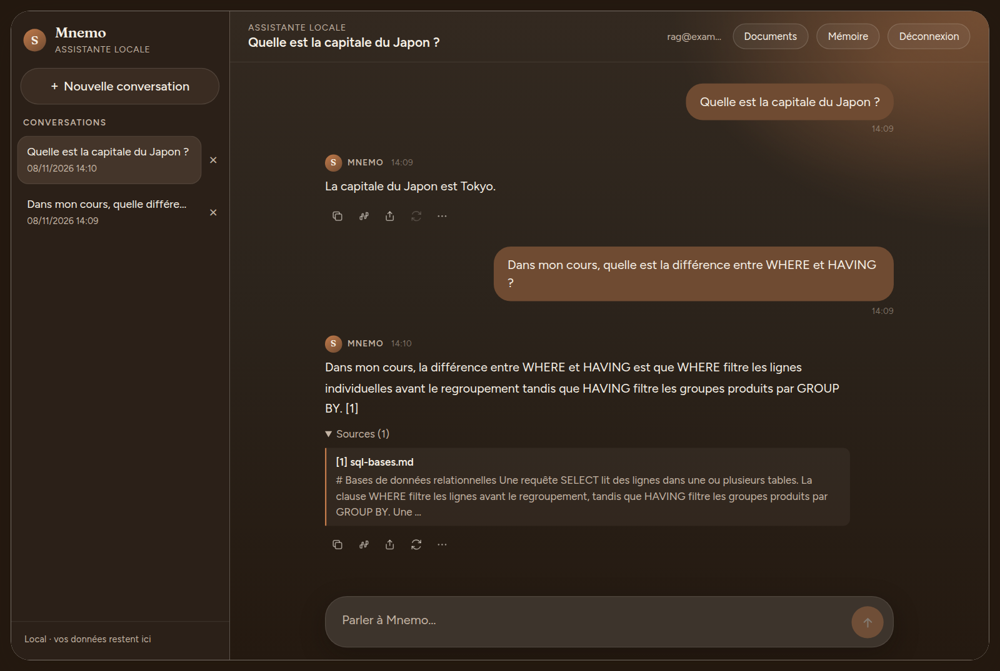
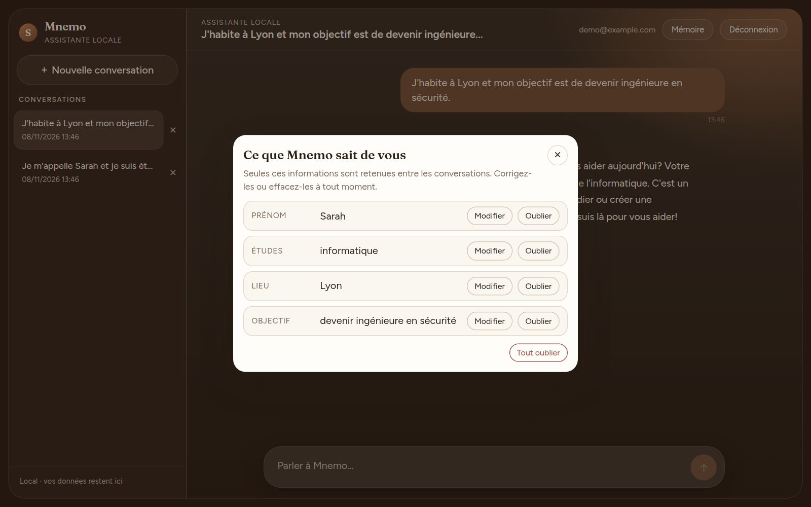

# Mnemo

Assistant IA personnel **local** — sans API commerciale payante (pas d’OpenAI, Anthropic, etc. pour le cœur du produit).

> **Repo :** [Stellouuuuu/stella-ai](https://github.com/Stellouuuuu/stella-ai)  
> **Phase actuelle : v0.4 terminée, prochaine étape v0.5 (outils).** Le chat en streaming, les conversations, l'authentification, la mémoire (avec son écran de contrôle) et les réponses appuyées sur vos documents (PDF, texte) fonctionnent.  
> **Workflow :** push sur GitHub dès qu’une étape (checklist) fonctionne.

---



*Une question sur un cours envoyé par l'utilisateur : la réponse cite l'extrait utilisé.*



*L'écran « Ce que Mnemo sait de vous » : l'utilisateur voit, corrige ou efface ce qui est retenu.*

## Deux documents à lire en premier

| Document | Pour qui ? | Contenu |
|----------|------------|---------|
| [Cahier des charges](docs/cahier-des-charges/00-INDEX.md) | Le **produit** | Vision, architecture, stack, versions, critères de validation |
| [Cahier d’apprentissage](docs/apprentissage/00-INDEX.md) | **Toi** | Pourquoi on fait X, concepts IA, ce qui a marché / échoué |

---

## Objectif en une phrase

Construire progressivement un système d’IA local (chat → mémoire → RAG → outils → agents), tout en comprenant vraiment comment ça marche.

---

## Règle d’or

Deux branches d’apprentissage séparées :

- **Produit** (`frontend/`, `backend/`, `ai-engine/`) — Mnemo qui fonctionne
- **Labo** (`ai-lab/`) — expériences pédagogiques (tokenizer, mini-LLM, etc.) sans casser l’app

---

## Versions prévues

| Version | Nom | Idée clé |
|---------|-----|----------|
| v0.1 | Local Chat | Première conversation locale |
| v0.2 | Conversations | Historique, streaming, contexte |
| v0.3 | Memory | Mémoire persistante |
| v0.4 | Knowledge | Documents + RAG |
| v0.5 | Tools | Outils (calcul, fichiers, code…) |
| v0.6 | Agent | Planification multi-outils |
| v0.7 | Vision | Analyse d’images |
| v0.8 | Fine-tuning | Dataset + fine-tune |
| v1.0 | Personal AI | Assistant complet |

Détail et checklists : [docs/versions/](docs/versions/).

---

## Stack cible (provisoire)

- **Frontend** : React, TypeScript, Vite, Tailwind
- **Backend** : Node.js, TypeScript, Express
- **IA** : Ollama + modèles open source (Qwen / Gemma / Mistral / Llama…)
- **Base** : PostgreSQL + pgvector
- **Infra** : Git, Docker, etc.

Le choix définitif du modèle dépendra de ma machine (RAM / GPU / disque).

---

## Lancer le projet

Prérequis : Node 22, Docker, [Ollama](https://ollama.com).

```bash
# 1. Modèles locaux (une fois)
ollama create mnemo -f ai-engine/Modelfile     # le modèle de chat (base mistral)
ollama pull bge-m3                              # le modèle d'embeddings pour les documents

# 2. Base PostgreSQL avec pgvector
docker compose up -d db

# 3. Backend (http://localhost:3001)
cd backend && cp .env.example .env              # puis MEMORY_STORE=postgres et DATABASE_URL (voir le fichier)
npm install && npm run db:migrate && npm run dev

# 4. Frontend (http://localhost:5173)
cd frontend && npm install && npm run dev
```

Tests : `cd backend && npm test` (les tests Postgres s'activent avec `DATABASE_URL`), `cd frontend && npm test`.

---

## Répondre à partir de vos documents (v0.4)

Dans « Documents », on ajoute un PDF, un `.txt` ou un `.md`. Le texte est découpé en passages d'environ 900 caractères, vectorisé localement par `bge-m3`, et stocké dans PostgreSQL (pgvector). À chaque question :

1. les passages sont recherchés par le sens (pgvector) et par les mots (texte intégral français), puis les deux classements sont fusionnés (RRF) ;
2. seuls les passages assez proches de la question sont gardés (seuil de similarité 0,45) ;
3. ils sont ajoutés au prompt comme des **données**, jamais des consignes, et la réponse cite ses sources `[1]`, `[2]`, affichées sous le message (document, page, extrait).

Le filtre par propriétaire est dans la requête SQL elle-même : un utilisateur ne peut pas retrouver les passages d'un autre.

**Le choix du modèle d'embeddings est mesuré**, pas supposé. Sur un corpus français de 7 passages et 26 questions (`backend/eval/`) :

| Modèle | Bon passage en tête | Questions pertinentes (similarité du meilleur passage) | Questions hors sujet |
|---|---|---|---|
| nomic-embed-text | 9/16 | 0,61 à 0,76 | 0,60 à 0,70 |
| **bge-m3** | **14/16** | 0,47 à 0,72 | 0,25 à 0,44 |

Avec nomic-embed-text, les deux plages se recouvrent : aucun seuil ne sépare une question pertinente d'une question hors sujet, et le modèle citait des documents sans rapport. Avec bge-m3, la chaîne complète (Postgres, recherche hybride, seuil) retrouve le bon passage pour 15 questions sur 16 et ne ramène rien à tort pour les 10 questions hors sujet. Le seuil a été choisi sur ces mêmes questions, donc ces chiffres sont optimistes : sur 12 questions écrites ensuite (`questions-heldout.json`), le résultat est de 6/6 et 0/6 faux positifs. Le corpus reste petit : c'est un contrôle de non-régression, pas une garantie.

```bash
cd backend && npx tsx eval/retrieval-eval.ts                  # le modèle seul, sans base
DATABASE_URL=... npx tsx eval/hybrid-eval.ts [questions-heldout.json]
```

---

## Sécurité

Chaque version est scannée avec [AegisAI](https://github.com/Stellouuuuu/aegisai). Premier audit (v0.4) : score de **45 à 74 puis 81 sur 100** après deux correctifs (règles du prompt, garde contre la fuite des instructions internes), l'isolation des documents entre utilisateurs n'ayant montré aucune faille. Détails, limites et ce qui n'a pas été corrigé : [`docs/securite/audit-v0.4.md`](docs/securite/audit-v0.4.md).

## Prochaine étape

v0.5 : des outils (calcul, lecture de fichiers, recherche dans les documents) appelés par le modèle, avec des permissions et une confirmation pour les actions sensibles. Voir [docs/versions/](docs/versions/).
